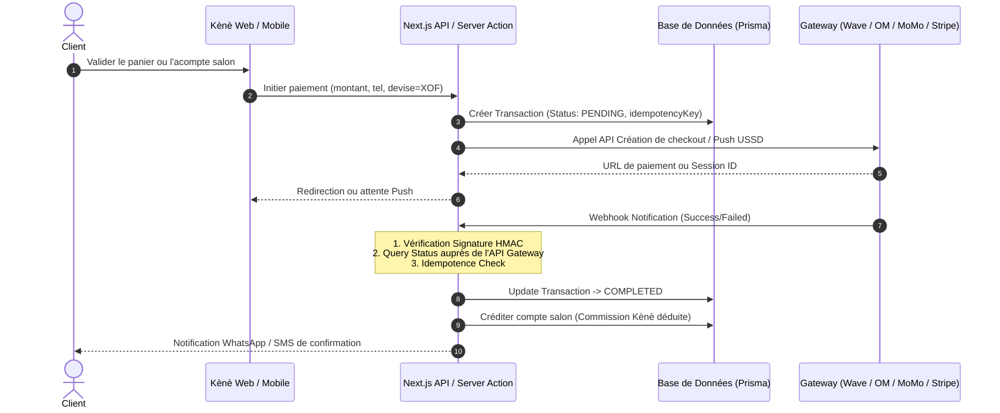

# Kènè Mobile Money & Financial Safeguard

Ce skill garantit la résilience maximale des transactions financières dans le contexte des réseaux et fournisseurs de paiement en Afrique de l'Ouest (Côte d'Ivoire, Sénégal, Mali, etc.).

## 1. Principes Fondamentaux d'Architecture

1. **Idempotence Absolue** :
   Chaque tentative de transaction doit porter un `transaction_id` unique (UUID v4 + timestamp). Si le client clique plusieurs fois ou si le webhook est renvoyé en double, l'API ne doit JAMAIS débiter ou valider deux fois.
   
2. **Signature Cryptographique des Webhooks** :
   - Vérifier systématiquement le header de signature (ex: `x-wave-signature` ou `x-cinetpay-hmac-sha256`) avec le secret enregistré en variable d'environnement chiffrée.
   - Ne jamais faire confiance au corps JSON brut sans valider la signature cryptographique.

3. **Double Vérification Serveur à Serveur (Server-to-Server Verification)** :
   - À la réception du webhook annonçant `PAYMENT_SUCCESS`, le serveur Kènè doit effectuer une requête synchrone d'interrogation d'état (Query Status API) vers le gateway avant de valider la commande ou de libérer la prestation en institut.

---

## 2. Cycle de Vie d'une Transaction Kènè

---

## 3. Gestion des Déconnexions & Réconciliation Automatique

- **Fallback Timeout** : En cas d'interruption du réseau GSM durant le push USSD, mettre en place un cron de polling (`/api/cron/reconcile-pending`) toutes les 10 minutes qui interroge les transactions `PENDING` datant de plus de 5 minutes.
- **Auto-Refund en cas d'erreur salon** : Si un rendez-vous est annulé ou en doublon, l'annulation et l'avoir doivent être tracés dans une table d'audit immuable (`AuditFinancialLog`).
