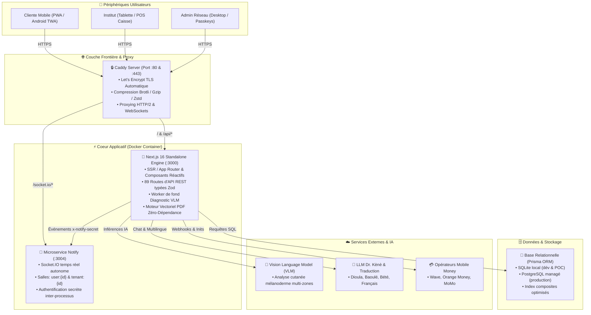
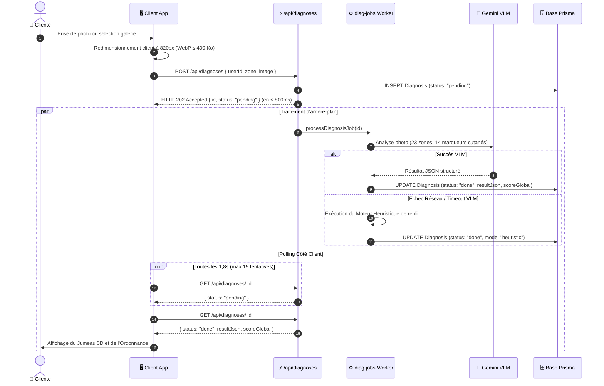

# 🏛️ Document d'Architecture Technique (TAD & System Design) — KÈNÈ

**Version :** 2.0 (Octobre 2026)  
**Public cible :** Développeurs Seniors, Tech Leads, Architectes Logiciels, Auditeurs  
**Plateforme :** Écosystème Global Kènè (Client PWA/TWA, Pro Institut OS, Admin Console, Infrastructure)

---

## 1. Vision & Architecture Globale (Modèle C4)

L'architecture de Kènè est conçue selon les principes de l'**informatique résiliente à haute disponibilité** adaptée aux réalités africaines (connexions mobiles intermittentes, coûts de bande passante, diversité des terminaux).

### 1.1 Diagramme de Contexte & Conteneurs (C4 Level 1 & 2)

---

## 2. Architecture Frontend (App 2026 UX & États)

### 2.1 Shell Applicatif Plein Écran Adaptatif (Responsive 3 Tiers)
L'application adopte un **Shell applicatif unifié 2026** sans rechargement de page (`single-page shell`) :
- **Mobile (< 768 px)** : Header Glassmorphism + Feed vertical + Barre de navigation inférieure à 5 onglets avec bouton central surélevé « Scanner » (CTA prioritaire).
- **Tablette (768 px – 1024 px)** : Rail d'icônes vertical à gauche (format TikTok iPad) libérant 100 % de la largeur pour les tableaux d'agenda et les indicateurs.
- **Desktop (≥ 1024 px)** : Sidebar gauche fixe (format Instagram Web) + colonne centrale de flux bornée à 640 px + rail d'actions rapides et profil à droite.

### 2.2 Gestion de l'État & Persistance Côté Client (`src/store/kene.ts`)
L'état global utilise **Zustand** avec le middleware `persist` (synchronisé dans `localStorage`) :
- **Utilisateur & Session** : `user` (profil, phototype, crédits, wallet), `activeTenantId` (institut sélectionné).
- **Navigation & Onglets** : `clientTab` (home, skin, care, shop, profile), `proTab` (overview, agenda, diagnostics, pos, crm, etc.).
- **Panier & Offline Sync** : `cart` (articles, quantités, codes promos appliqués, sélection d'institut vendeur).

### 2.3 Rendu Procédural 3D & Stratégie de Secours Statique
Le buste 3D (`SkinTwin`) et les bandes de Kente tissées utilisent `@react-three/fiber` (Three.js) avec une discipline stricte :
1. **Plafond DPR (Device Pixel Ratio)** : Limité à 1.5 sur mobile pour éviter la surchauffe GPU.
2. **Frameloop à la demande** : L'animation s'arrête dès que le modèle est stationnaire (`frameloop="demand"`).
3. **Fallbacks logiciels immédiats** :
   - Détection de `prefers-reduced-motion` : suspension des rotations.
   - Mode **Clair de Lune** (`#moonlight`) ou échec WebGL : bascule automatique vers un rendu SVG/WebP statique ultra-léger sans crash de l'interface.

---

## 3. Pipeline Asynchrone d'Analyse Cutanée (VLM)

Le traitement d'une photo de peau pour analyse dermatologique suit un flux asynchrone non-bloquant pour garantir un temps de réponse perçu < 1 seconde :

---

## 4. Pipeline Média & Optimisation de la Base de Données

### Le Problème du « Base64 Bloat »
Stocker et retourner des chaînes Base64 dans les requêtes de listes d'API (`/api/diagnoses`, `/api/shop/products`, `/api/institutes`) provoquait des transferts de plusieurs dizaines de mégaoctets sur mobile.

### La Solution Kènè : Isolation des Médias
1. **Projection Légère par Défaut** :
   - `/api/diagnoses` exclut le champ volumineux `imageData` par défaut (`light=1`). La liste des 20 derniers diagnostics pèse **8 Ko au lieu de 15 Mo**.
   - Le champ binaire n'est fourni que lors de l'appel ciblé d'un scan unitaire (`/api/diagnoses/:id?full=1`).
2. **Service Média Dédié (`/api/media/[type]/[id]`)** :
   - Les photos réelles d'instituts, de produits et les avatars de clientes sont servies via des URL HTTP dédiées.
   - En-têtes HTTP de mise en cache appliqués : `Cache-Control: public, max-age=86400, stale-while-revalidate=604800`.
   - Migration naturelle prête vers du stockage d'objets cloud (Amazon S3 / Cloudflare R2 / MinIO).

---

## 5. Moteur Vectoriel PDF Zéro-Dépendance (`src/lib/accounting/pdf.ts`)

Pour éviter les lourdeurs de dépendances externes (comme Puppeteer ou wkhtmltopdf) qui consomment des centaines de mégaoctets de RAM :
- Kènè embarque un **moteur de rendu PDF vectoriel natif** écrit en TypeScript pur.
- **Spécification binaire PDF 1.4** : Génération directe des flux d'objets PDF (`stream`, dictionnaires, matrices de transformation, polices Helvetica WinAnsi).
- **Documents générés instantanément (< 50 ms)** :
  1. **Ordonnance Dermo-Cosmétique** : Graphique spectral des indicateurs, routine matin/soir, actifs botaniques clés et Pass Cabine QR vectoriel.
  2. **Fiche de Consultation Cabine (A4)** : Fiche médicale à signer par la cliente (avec zone d'empreinte digitale ou signature manuscrite).
  3. **Liasse Comptable SYSCOHADA (A4)** : Bilan, compte de résultat et grand livre prêts pour l'administration fiscale.

---

## 6. Microservice Temps Réel (`mini-services/notify-service`)

Un microservice indépendant sous Node/Bun gère les communications bidirectionnelles :
- **Port d'écoute** : `3004` (interne), exposé via le reverse proxy Caddy sous `/socket.io/`.
- **Topologie des Salles** :
  - `user:{userId}` : Notifications d'évolution de peau, relances RDV, crédits cashback.
  - `tenant:{tenantId}` : Alertes institut en direct (nouveau RDV, commande boutique passée, alerte stock).
- **Sécurité Inter-Processus** : L'API Next.js émet des notifications vers le service socket via une requête HTTP POST sécurisée par l'en-tête `x-notify-secret`. En cas d'indisponibilité du service socket, le front bascule de manière transparente sur un polling HTTP léger de secours (8 s).

---

## 7. Modèle de Données & Stratégie d'Indexation (Prisma)

Le schéma relationnel (`prisma/schema.prisma`) garantit l'intégrité référentielle et la multi-tenance étanche :
- **Multi-Tenancy** : Chaque institut (`Tenant`) est strictement isolé. Toutes les requêtes Pro filtrent obligatoirement par `where: { tenantId }`.
- **Index Composites Critiques** :
  - `Appointment` : `@@index([tenantId, startAt])` (accès instantané à l'agenda du jour).
  - `Diagnosis` : `@@index([userId, createdAt])` (historique chronologique de la cliente).
  - `ClientProfile` : `@@unique([tenantId, phone])` (dédoublonnage des fiches clientes par salon).
  - `FollowUpMark` : `@@unique([tenantId, dedupKey])` (idempotence des relances WhatsApp).
