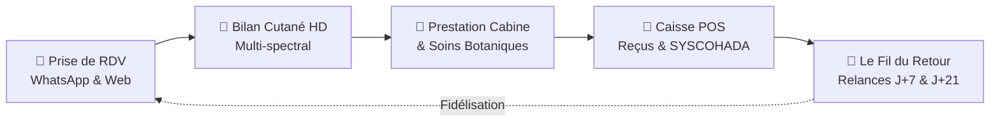

# 🌺 Kit Commercial & Documents de Persuasion Kènè

Ce document constitue la boîte à outils commerciale et persuasive officielle de la plateforme **Kènè**. Il est conçu pour convertir rapidement et massivement les deux segments clés de l'écosystème :
1. **Les Gérantes & Propriétaires d'Instituts, Salons & Spas (B2B)**.
2. **Les Clientes finales aux peaux noires et métissées (B2C)**.

---

## 📑 Sommaire
1. **Plaquette Commerciale B2B (One-Pager Décisionnaire pour les Gérantes)**
2. **Séquence WhatsApp de Prospection & Signature Directe (3 étapes)**
3. **Chevalet de Comptoir, Affichette Cabine & Script Praticienne (B2C)**
4. **Guide Ultime de Traitement des Objections Terrain**
5. **Procédure de Lancement « Les 10 Salons Pionniers »**
6. **Le Flyer Format Poche A6 / Carte Pass VIP de Sortie**
7. **Générateur de Messages WhatsApp à Fort Taux d'Action**
8. **Convention Officielle de Partenariat & Conformité Juridique**

---

# 1. Plaquette Commerciale B2B — « Kènè Pro Établissement »
*(Support décisionnaire à remettre en main propre ou à envoyer au format PDF interactif via WhatsApp Business)*

---

### **KÈNÈ PRO — LA RÉFÉRENCE TECHNOLOGIQUE DES INSTITUTS DE BEAUTÉ D'AFRIQUE DE L'OUEST**

> **« Modernisez votre institut, éliminez les rendez-vous manqués et prouvez scientifiquement l'efficacité de vos soins cabine. »**

---

### Pourquoi les meilleurs salons choisissent Kènè Pro ?

Gérer un institut de beauté avec des cahiers papier et des échanges WhatsApp éparpillés fait perdre du temps, de la sérénité et du chiffre d'affaires. Kènè Pro rassemble toute la gestion de votre salon dans une application unique, simple, intuitive et calibrée pour les réalités ouest-africaines :



* **Zéro Rendez-Vous Perdu (Anti-No-Show)** :  
  Vos clientes reçoivent automatiquement leurs confirmations et rappels bienveillants sur WhatsApp la veille. Résultat : **réduction de 85 % des rendez-vous oubliés**.
* **Le Bilan Cutané Haute Précision qui déclenche la vente** :  
  Grâce au scanner dermo-biométrique spécialement calibré pour les peaux noires et métissées (phototypes IV à VI), vous révélez à votre cliente l'état sous-jacent de sa peau (taches d'hyperpigmentation naissantes, déshydratation, excès de sébum) et lui montrez la preuve tangible Avant / Après votre soin cabine.
* **Caisse Tactile & Reçus Thermiques / WhatsApp** :  
  Encaissez en Espèces, Wave ou Orange Money en 3 secondes. Imprimez des tickets professionnels ou envoyez-les directement par WhatsApp avec ventilation de TVA 18 % conforme SYSCOHADA.
* **Fidélisation Automatique « Le Fil du Retour »** :  
  L'application prépare vos messages de suivi à J+3 (tolérance du soin) et J+21 (renouvellement de routine) sans que vous ayez à y penser.
* **Contrôle Total & Sécurité Hermétique** :  
  Vos employées accèdent uniquement à leur agenda et à leur cabine. Vos chiffres d'affaires, vos marges, vos salaires et vos comptes bancaires restent strictement confidentiels et verrouillés par votre code PIN personnel de gérante.

---

### Une Offre Partenaire Sans Risque

| Formule | Ce qui est inclus | Tarif Partenaire |
| :--- | :--- | :--- |
| **Pass Découverte** | **1er Mois 100 % Gratuit** (Accès complet sans engagement, installation assistée) | **0 FCFA** |
| **Pro Institut** | Caisse POS tactile, Multi-cabines, Bilans HD illimités, Relances auto, Gestion des stocks | **20 000 FCFA/mois**<br>*(Dégressif jusqu'à 10 000 F)* |
| **Pro Complexe** | Tout Pro Institut + Paie CNPS/IPM, Liasse fiscale SYSCOHADA, Multi-succursales | **30 000 FCFA/mois**<br>*(Dégressif jusqu'à 20 000 F)* |

> 🌸 **Le Bonus Exclusif Équipe** : L'abonnement VIP **Kènè+ personnel est offert à 100 % pour toutes vos collaboratrices** tant que votre salon est partenaire. Vos esthéticiennes testent les soins sur leur propre peau et deviennent vos plus formidables ambassadrices !

---

# 2. Séquence WhatsApp de Prospection & Signature B2B

*En Afrique de l'Ouest, WhatsApp est le canal par excellence pour initier une relation commerciale. Voici la séquence éprouvée en 3 messages.*

---

### Message 1 : Prise de contact valorisante
> *« Bonjour Madame [Nom de la Gérante], je suis [Votre Prénom] de chez Kènè Beauté. Je suis avec beaucoup d'attention l'élégance et la qualité des soins prodigués chez [Nom du Salon].*  
> *Nous accompagnons les plus beaux instituts d'Abidjan [ou Dakar] pour éliminer les rendez-vous manqués et offrir à leurs clientes une expérience cabine digne des plus grands centres internationaux grâce à notre scanner de peau sur tablette.*  
> *Accepteriez-vous que je vienne vous faire une démonstration de 10 minutes directement à votre salon ce jeudi ou vendredi ? »*

---

### Message 2 : Preuve par l'exemple (Social Proof)
*(À envoyer après leur réponse d'intérêt ou en relance courtoise après 48h)*
> *« Bonjour Madame [Nom], voici en 1 minute ce que notre partenaire, le Cabinet LA DERMO, a constaté après 3 semaines d'utilisation :*  
> *1. Des clientes impressionnées par le bilan de peau Avant/Après qui achètent leur routine sans hésiter.*  
> *2. Zéro oubli de rendez-vous grâce aux rappels WhatsApp automatiques.*  
> *3. Une caisse claire et maîtrisée en fin de journée sans aucune erreur.*  
> *Pour célébrer notre lancement, nous vous offrons votre 1er mois d'accès complet 100 % gratuit, sans aucune carte bancaire ni engagement. Quel est le meilleur moment pour paramétrer votre salon ensemble ? »*

---

### Message 3 : Clôture & Préparation de visite
> *« Parfait Madame [Nom] ! Je viens avec la tablette configurée pour [Nom du Salon]. Vos collaboratrices recevront également leur accès personnel offert pour tester l'application sur leur propre peau. À très vite chez [Nom du Salon] ! 🌿 »*

---

# 3. Chevalet de Comptoir & Affichette Cabine (B2C)
*(À imprimer et plastifier, format A5 chevalet de comptoir ou A4 miroir de cabine)*

```
┌──────────────────────────────────────────────────────────────┐
│                                                              │
│                   🌺 KÈNÈ BEAUTÉ & SOINS                     │
│                                                              │
│                VOTRE PEAU MÉRITE LA VÉRITÉ                   │
│                                                              │
│       Découvrez la santé profonde de votre épiderme grâce    │
│            à notre Bilan Dermo-Biométrique Haute Précision   │
│                                                              │
│              [ SCANNER LE QR CODE ICI ]                      │
│                                                              │
│   ✨ Analyse instantanée des taches, hydratation & sébum      │
│   ✨ Routine sur mesure formulée aux trésors botaniques      │
│      d'Afrique (Karité de Korhogo, Baobab, Moringa)          │
│   ✨ Suivi d'évolution tactile Avant / Après en 30 jours      │
│                                                              │
│           Votre 1er Mois de Pass VIP Kènè+ est 100% OFFERT   │
│               Demandez conseil à votre praticienne           │
│                                                              │
└──────────────────────────────────────────────────────────────┘
```

### Le Script d'Accueil au Fauteuil (Par l'Esthéticienne) :
> *« Madame [Prénom], avant de débuter votre rituel éclat aujourd'hui, nous allons faire un bilan dermo-biométrique en 10 secondes. Vous allez voir exactement comment vos cellules réagissent sous la peau. À la fin du soin, nous referons le scan pour que vous puissiez constater vous-même le gain d'hydratation et l'éclat Avant/Après. Vous recevrez l'analyse complète directement sur votre téléphone. »*

---

# 4. Guide Imparable de Traitement des Objections

### Objection 1 (Gérante) : *« J'ai déjà un cahier et WhatsApp, ça me suffit amplement. »*
* **Réponse** :  
  *« Votre cahier est précieux, mais il ne peut pas envoyer un rappel automatique à votre cliente la veille à 19h pour s'assurer de sa venue, ni décompter votre stock en temps réel dès qu'une crème est vendue. Combien de rendez-vous avez-vous manqués ce mois-ci ? Si Kènè vous évite ne serait-ce que 2 rendez-vous oubliés par mois, l'outil est déjà rentabilisé cinq fois. Et le premier mois est 100 % gratuit sans engagement : vous ne prenez absolument aucun risque à tester. »*

### Objection 2 (Gérante) : *« Mes collaboratrices ne sont pas très à l'aise avec la technologie. »*
* **Réponse** :  
  *« Kènè a été pensé pour être aussi simple que WhatsApp ou Wave. Aucun paramétrage compliqué : un bouton pour scanner, un bouton pour encaisser. En 15 minutes d'installation avec nous au salon, toute votre équipe saura s'en servir. De plus, nous offrons à chacune un compte personnel VIP Kènè+ offert pour qu'elles s'amusent à scanner leur propre peau et se familiarisent avec l'outil. »*

### Objection 3 (Gérante) : *« J'ai peur que mes employées voient mes chiffres ou mes marges. »*
* **Réponse** :  
  *« C'est précisément l'une des forces majeures de Kènè : le cloisonnement est hermétique. Vos employées voient uniquement l'agenda et la fiche de soin de la cliente en cabine. Vos chiffres d'affaires, vos marges, vos données de paie et vos paramètres de salon sont strictement invisibles pour elles et protégés par votre code PIN confidentiel de gérante. »*

### Objection 4 (Cliente) : *« Pourquoi devrais-je utiliser Kènè+ si je fais déjà des soins en institut ? »*
* **Réponse** :  
  *« Vos soins en cabine sont l'étape fondamentale, mais 80 % des résultats sur les taches et l'éclat se jouent à la maison avec la régularité de votre routine quotidienne. Kènè+ agit comme votre dermatologue de poche 24h/24 : il analyse l'évolution de vos taches semaine après semaine, vous conseille sur vos soins botaniques et vous fait bénéficier de remises exclusives sur vos produits en institut. De plus, vous avez 30 jours offerts pour tester sans dépenser 1 seul franc. »*

---

# 5. Procédure de Lancement « Les 10 Salons Pionniers »

Pour maximiser l'effet réseau et la preuve sociale lors du déploiement :
1. **Sélectionner 10 salons de référence** à Abidjan (Cocody, Marcory, Plateau) et Dakar (Almadies, Plateau).
2. **Leur attribuer le label officiel** « Institut Partenaire Pilote Kènè ».
3. **Avantages exclusifs offerts** :
   * Installation physique sur place par un ambassadeur Kènè.
   * Formation personnalisée de toute l'équipe (1 heure).
   * Mise en avant prioritaire dans l'annuaire dermo-beauté de la plateforme.
   * 1er mois d'accès 100 % offert et Pass Kènè+ VIP offert à tout le personnel.
4. **Collecter les témoignages vidéo Avant/Après** dès J+21 pour alimenter les réseaux sociaux de Kènè.

---

# 6. Le Flyer Format Poche A6 / Carte Pass VIP de Sortie

Ce support de format carte postale A6 (105 mm x 148 mm) est imprimable directement depuis l'espace Pro. Il est remis en main propre par la praticienne ou la caissière lors du règlement :

### Structure du Recto / Verso :
* **En-tête de prestige** : Logo Kènè or & terre cuite avec mention « KÈNÈ VIP PASS · Institut Partenaire ».
* **QR Code d'accès direct** : Scannable sans installation préalable, menant directement à la fiche personnalisée de l'institut.
* **Zones manuscrites à remplir par la praticienne** :
  * Nom de la cliente.
  * Score d'éclat / hydratation obtenu lors du bilan cabine (ex: `84 %`).
  * Praticienne référente.
  * Date conseillée pour le prochain rituel en institut.
* **Avantage Fidélité** : Rappel des 30 jours offerts sur le Pass VIP Kènè+ et réduction exclusive au prochain soin.

---

# 7. Générateur de Messages WhatsApp à Fort Taux d'Action

Intégré nativement dans l'onglet *WhatsApp* du modal commercial Pro, ces messages permettent à la gérante et à son équipe de contacter leurs clientes en 1 clic :

1. **Invitation VIP & Diagnostic Offert** :
   > *« Bonjour ! Chez [Nom du Salon], nous vous offrons votre bilan de santé de peau complet en 10 secondes grâce à notre scanner dermo-biométrique. Découvrez la routine botanique idéale pour votre épiderme et activez vos 30 jours offerts Kènè+ : [Lien Institut] »*

2. **Compte-rendu Post-Soin Immédiat** :
   > *« Bonjour ! Toute l'équipe de [Nom du Salon] vous remercie pour votre visite. Votre soin en cabine a restauré l'éclat de votre peau. Retrouvez votre compte-rendu personnalisé et vos conseils botaniques sur votre espace sécurisé : [Lien Institut] »*

3. **Relance Bienveillante à J+21 (Renouvellement Cellulaire)** :
   > *« Bonjour ! Voilà 3 semaines depuis votre dernier rituel chez [Nom du Salon]. Votre cycle de régénération cellulaire arrive à maturité : c'est le moment idéal pour faire votre bilan de suivi cabine et consolider votre éclat. Réservez votre créneau ici : [Lien Institut] »*

---

# 8. Convention Officielle de Partenariat & Conformité Juridique

Pour officialiser l'affiliation de chaque établissement sans incertitude juridique, le document contractuel de référence est consultable à l'adresse suivante :
👉 [`docs/CONTRAT_PARTENARIAT_INSTITUT.md`](file:///d:/Projet%20Tic/Projet_Antigravity/K%C3%A8n%C3%A8/docs/CONTRAT_PARTENARIAT_INSTITUT.md)

Il régit de manière stricte et équilibrée :
* **La Charte Anti-Dépigmentant** : Tolérance zéro pour l'hydroquinone, les corticoïdes et les sels de mercure.
* **La Propriété des Données** : La patientèle et les chiffres d'affaires restent la propriété inaliénable du salon.
* **La Quarantaine des Salariés** : Protection hermétique des marges et données de paie.
* **L'Avantage Employée** : Pass Kènè+ offert à toutes les praticiennes déclarées.

