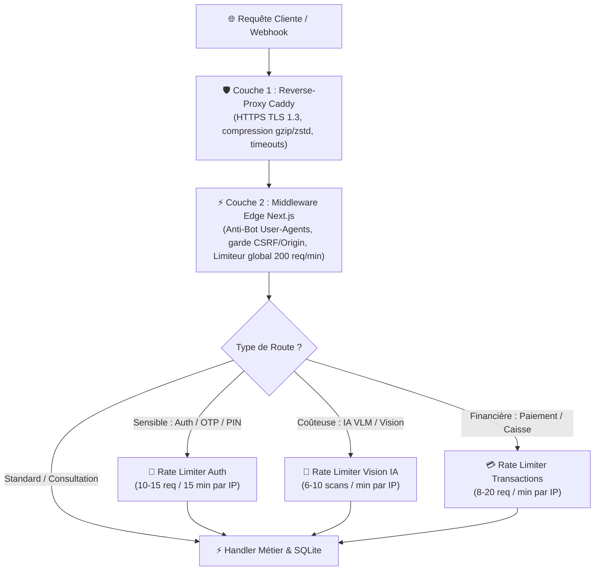

# 🛡️ Architecture de Sécurité & Conformités Réglementaires — KÈNÈ

**Version :** 2.0 (Octobre 2026)  
**Normes de Référence :** NIST SP 800-63B-4, OWASP ASVS 4.0 (V2.7), Droit Comptable SYSCOHADA, Norme CNPS / IPM, RGPD / Lois APDP  
**Portée :** Données Médicales/Cutanées, Flux Financiers, Gestion Sociale, Console d'Administration

---

## 1. Posture de Sécurité Applicative & Cryptographie

L'architecture de Kènè applique le principe du **moindre privilège** et de la **défense en profondeur**.

### 1.1 Matrice d'Authentification & Sessions

| Espace | Durée de Session | Mécanisme d'Authentification | Politiques de Sécurité |
| :--- | :--- | :--- | :--- |
| **Cliente** | 90 jours glissants | OTP SMS / Reconnexion Express / PIN 4 chiffres | Cookie HTTPOnly, `SameSite=Lax`, signé HMAC-SHA256. |
| **Pro (Institut)** | 30 jours | Numéro Pro + PIN ou OTP SMS | Isolation stricte des données par `tenantId`. Session requise sur toutes les routes `/api/pro/*`. |
| **Console Admin** | **8 heures max** | **WebAuthn Passkeys (FIDO2)** ou OTP 6 chiffres | Séparation stricte de l'URL (`/console`). **Step-up obligatoire** avant toute action d'administration. |

### 1.2 Le Protocole Step-up (OWASP ASVS V2.7)
Pour prévenir les prises de contrôle de session administrative ou les actions malveillantes :
- Toute action destructrice ou financière (suspension d'un institut, modification d'une commission, octroi de mois d'abonnement offerts, promotion d'un utilisateur) requiert une **élévation de privilège fraîche (< 5 minutes)**.
- Si le délai de 5 minutes est dépassé, l'API renvoie le code d'erreur standard :
  ```json
  { "error": "Authentification renforcée requise", "code": "elevation_required" }
  ```
- L'interface ouvre automatiquement un dialogue de validation biométrique (Passkey) ou de code de sécurité, puis rejoue immédiatement l'action sans friction pour l'administrateur.

---

## 2. Conformité Légale & Comptable Ouest-Africaine (SYSCOHADA)

Kènè Pro intègre un moteur de caisse et de comptabilité conforme au **Système Comptable Ouest-Africain (SYSCOHADA Révisé)** applicable dans les 17 États membres de l'OHADA :

### 2.1 Immuabilité du Grand Livre & Écritures
1. **Zéro Écrasement** : Une écriture comptable validée en caisse (POS) ou lors d'une commande ne peut être ni modifiée ni supprimée.
2. **Correction par Contre-Passation** : Toute annulation ou remboursement donne lieu à une nouvelle écriture d'ajustement en sens inverse.
3. **Plan de Comptes Intégré (Classes 1 à 7)** :
   - `571100` : Caisse Principale (Espèces / Mobile Money).
   - `701100` : Ventes de produits dermo-cosmétiques.
   - `706100` : Prestations de soins en cabine.
   - `602000` : Achats de matières premières (actifs botaniques).
   - `443100` : État, TVA facturée sur ventes (18 %).

---

## 3. Conformité Sociale & Déclarations de Paie (e-CNPS / IPM)

Le module de paie de Kènè Pro calcule automatiquement les cotisations patronales et salariales selon les barèmes en vigueur :

### 3.1 Côte d'Ivoire (Barèmes CNPS & Impôts sur Salaires)
- **Régime Général CNPS** : Retraite (salarié 6,3 %, employeur 7,7 %), Prestations familiales (5,75 %), Accidents du travail (2 à 5 %).
- **Fiscalité Locale** : Impôt Général sur le Revenu (IGR), Contribution Nationale (CN), Impôt sur Salaire (IS 1,2 %).
- **Fichier Déclaration e-CNPS** : Génération en 1 clic du fichier **XML normalisé** prêt pour le téléversement sur le portail de télédéclaration de la CNPS de Côte d'Ivoire.

### 3.2 Sénégal (Barèmes IPRES & IPM)
- **IPRES** : Régime général (salarié 5,6 %, employeur 8,4 %) et Régime cadres.
- **IPM (Institution de Prévoyance Maladie)** : Taux légal de 3 % partagé employeur/salarié.

---

## 4. Protection des Données de Santé & Respect du RGPD / Lois APDP

Kènè respecte les réglementations sur les données à caractère personnel (Loi ivoirienne n° 2013-450 sur la protection des données personnelles, loi sénégalaise 2008-12 et RGPD européen) :

### 4.1 Double Consentement Explicite Préalable
Avant toute analyse de peau par l'IA ou en cabine :
1. **Case 1 (Données Cutanées)** : Accord explicite pour le traitement algorithmique des indicateurs de peau et antécédents.
2. **Case 2 (Conservation des Photos)** : Accord distinct pour le stockage sécurisé des photographies de visage à des fins de suivi comparatif.
*Ces consentements sont horodatés et archivés numériquement en base de données.*

### 4.2 Portabilité des Données (Droit d'Accès Art. 20)
Chaque cliente dispose dans son profil d'un bouton **« Exporter mes données »** :
- Génère en 1 clic un fichier JSON standardisé et lisible contenant l'intégralité de ses diagnostics, scores, commandes, rendez-vous et consentements.

### 4.3 Droit à l'Effacement & Purge Légale (Droit à l'Oubli)
Lorsqu'un utilisateur demande la suppression définitive de son compte :
1. **Purge Immédiate des Données de Santé** : Les photos du visage, les résultats d'analyses VLM et les fiches cutanées sont immédiatement détruits de manière irréversible.
2. **Conservation Légale Anonymisée** : Conformément aux obligations fiscales et comptables (SYSCOHADA exigeant 10 ans de conservation des écritures), les factures et transactions sont conservées sous forme strictement anonymisée (remplacement du nom par *"Compte Utilisateur Supprimé"* et numéro de téléphone masqué).

---

## 5. Stratégie de Rate Limiting & Protection Anti-DDoS

Pour préserver la disponibilité du service, l'intégrité de la base de données SQLite et les coûts des GPU / API d'intelligence artificielle, Kènè déploie une **protection multicouche** :



### 5.1 Grille des Presets de Limitation (`src/lib/kene/rate-limit.ts`)

| Famille d'Action | Limite / Fenêtre | Routes Concernées | Menace Contrôlée |
| :--- | :--- | :--- | :--- |
| **Garde DoS Global** | 200 req / min | Tout `/api/*` (hors `/health` et webhooks) | Inondation serveur & saturation SQLite |
| **Demande OTP SMS** | 10 req / 15 min | `/api/auth/otp/request` | Spam SMS, épuisement forfait passerelle |
| **Validation OTP** | 12 req / 15 min | `/api/auth/otp/verify` | Brute-force du code à 6 chiffres |
| **Connexion Code PIN** | 15 req / 15 min | `/api/auth/login`, `/api/auth/pin` | Brute-force du code PIN 4 chiffres |
| **Passkeys Console** | 12 req / 15 min | `/api/admin/passkey/login/*` | Attaques par rejeu FIDO2 / énumération |
| **Élévation Step-up** | 12 req / 15 min | `/api/admin/elevate` | Tentatives d'escalade de privilège |
| **Scanner Vision IA (VLM)** | 6 scans / min | `/api/diagnoses` | Surcoût cloud IA, abus de scan dermo |
| **Scanner Pro Cabine** | 10 scans / min | `/api/pro/diagnoses` | Cadence humaine normale en institut |
| **Paiements & Checkout** | 12 req / min | `/api/payments/*/init`, `/api/orders` | Injection frauduleuse, double débit |
| **Recharge Wallet** | 8 req / min | `/api/wallet/topup` | Fraude monétaire, spam de requêtes |
| **Codes Promo** | 15 req / min | `/api/coupons/validate` | Énumération automatisée de réductions |
| **Suppression de compte**| 5 req / 15 min | `/api/auth/delete-account` | Attaque malveillante sur code PIN |
| **Export RGPD** | 6 req / 15 min | `/api/profile/export` | Surcharge CPU (requête multi-tables) |
| **Diffusion Coupons SMS**| 4 req / min | `/api/pro/coupons/diffuse` | Mass-spam vers toute la patientèle |

### 5.2 Algorithme & Spécificités Techniques
1. **Fenêtre Glissante en Mémoire (Sliding Window)** : Calcul exact basé sur les horodatages réels des hits (`Date.now()`). Aucun effet de seuil brutal en début de minute.
2. **Zéro Dépendance Externe** : Fonctionne en mémoire vive mono-processus sans nécessiter Redis, éliminant tout point de défaillance réseau.
3. **Purge Paresseuse (Lazy Clean)** : Nettoyage automatique des clés inactives toutes les 5 minutes lors des appels, garantissant **zéro fuite de mémoire** et aucun timer d'arrière-plan permanent.
4. **Réponse 429 Standardisée** :
   ```json
   {
     "error": "Trop de tentatives — réessaie dans quelques minutes",
     "retryAfterSec": 45
   }
   ```
   Accompagnée du header standard HTTP `Retry-After: 45` interprété directement par le front-end pour afficher un compte à rebours dynamique à l'utilisateur.

---

## 6. Les 5 Boucliers de Sécurité Avancée Kènè

En complément des gardes de périmètre, Kènè déploie 5 boucliers de cyberdéfense proactive :

### 6.1 Bouclier 1 : Pot de Miel (Honeypot) & Prison IP en Mémoire Edge
- **Détection des sondes d'attaque** : Piège actif sur les chemins de reconnaissance malveillants (`/.env`, `/.git`, `/wp-admin`, `/xmlrpc.php`, `/phpmyadmin`, `/actuator`, `/solr`, `/boaform`...).
- **Isolement instantané (Micro-Fail2ban)** : Dès qu'une IP sonde l'un de ces chemins interdits, elle est bannie immédiatement en mémoire Edge pour **30 minutes**.
- **Refus systématique** : Toutes ses requêtes ultérieures reçoivent une réponse HTTP `403 Forbidden` sans solliciter le serveur d'application ni la base de données.

### 6.2 Bouclier 2 : Défense Anti-JSON Bomb & Anti-Pollution de Prototype
- **Plafonnement des charges utiles** : Les requêtes mutantes (`POST`, `PUT`, `PATCH`) sont limitées à **512 Ko** par défaut (avec dérogation jusqu'à 10 Mo pour les photos cutanées de diagnostic et médias certifiés). Tout payload excédentaire est rejeté avec un code `413 Payload Too Large`.
- **Neutralisation de prototype (`security-sanitize.ts`)** : Nettoyage récursif des objets JSON avant traitement pour neutraliser toute tentative d'injection de clés réservées (`__proto__`, `constructor`, `prototype`).

### 6.3 Bouclier 3 : Verrouillage Progressif de Compte & Alerte WhatsApp
- **Protection PIN** : Dès 5 tentatives consécutives de code PIN ou mot de passe erroné, le compte est automatiquement verrouillé pendant **15 minutes**.
- **Notification d'alerte en temps réel** : Un message de sécurité d'urgence est immédiatement envoyé sur le WhatsApp de l'utilisatrice pour l'avertir de l'activité suspecte et lui permettre de réagir ou de réinitialiser ses accès par SMS.

### 6.4 Bouclier 4 : Chaînage Cryptographique Inaltérable des Ventes (SYSCOHADA)
- **Scellement par Hash Chaîné (Blockchain-lite)** : Chaque vente enregistrée en caisse calcule une empreinte cryptographique `SHA-256` incluant le hash de la vente précédente, le montant HT/TVA/TTC, l'identifiant institut, le mode de paiement et l'horodatage.
- **Preuve d'intégrité fiscale** : Toute altération, insertion ou suppression frauduleuse d'une ligne de vente dans la base de données brise mathématiquement la chaîne d'intégrité, rendant toute tentative de fraude détectable lors des audits fiscaux et comptables.

### 6.5 Bouclier 5 : Détection de Déplacement Impossible & Anomalies de Vélocité
- **Vérification de vélocité géographique** : Lors de chaque authentification réussie, la géolocalisation et l'adresse IP sont confrontées à l'historique récent du compte.
- **Alerte voyage impossible** : Une connexion détectée depuis un pays ou un sous-réseau distant dans un délai physiquement impossible (< 60 minutes) déclenche un événement d'audit de haute sévérité et notifie instantanément le propriétaire du compte.

