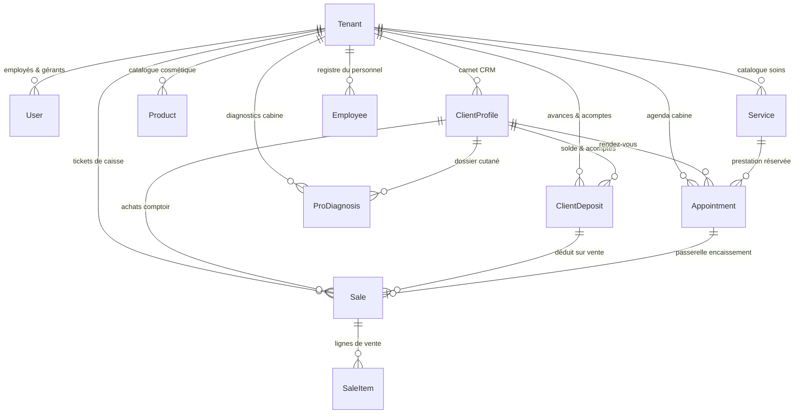

# 📘 KÈNÈ OS — Spécification Complète d'Ingénierie & Guide de Reproduction Multi-Langages

> **Version du document :** 3.0 (Novembre 2026)  
> **Objet :** Cahier des charges formel, logique métier, algorithmes et schémas relationnels permettant à une équipe d'ingénierie quelconque de reproduire intégralement la plateforme KÈNÈ dans un autre écosystème technologique (Python/FastAPI/Django, Go/Gin, Java/Spring Boot, C#/.NET Core, PHP/Laravel, Rust).

---

## 1. Vue d'Ensemble & Mission du Système

KÈNÈ est un écosystème dermo-cosmétique et d'exploitation d'instituts de beauté haut de gamme, conçu pour les peaux mélanodermes (phototypes IV à VI) et le commerce en Afrique de l'Ouest (Sénégal, Côte d'Ivoire, Mali, etc.).

Le système se compose de deux univers interconnectés :
1. **L'Univers Client (B2C)** : Application web progressive (PWA/TWA) permettant l'auto-diagnostic de peau assisté par vision par ordinateur (VLM), le suivi de routine cosmétique (matin/soir), la boutique d'actifs botaniques et la réservation de soins en cabine.
2. **L'Univers Entreprise (B2B Pro OS)** : Système d'exploitation d'institut structuré en 5 pôles métiers (Pilotage, Clinique & Cabine, Caisse & Commerce, Relation & CRM, RH & Administration).

---

## 2. Modèle de Données Universel (Schéma Relationnel Entité-Association)

Le schéma ci-dessous décrit l'intégralité des tables et relations du modèle relationnel Kènè.

### 2.1 Les Entités Piliers

#### A. `Tenant` (L'Établissement / Salon / Clinique)
- `id` (String PK, UUID/CUID)
- `name` (String, Raison sociale)
- `slug` (String Unique, URL de partage et QR code)
- `city`, `district`, `address`, `phone`, `email`
- `currency` (String, défaut "XOF")
- `posSettings` (JSON : TVA applicable, seuils de fonds de caisse, modes de paiement autorisés)

#### B. `ClientProfile` (Fiche CRM & Dossier Patient 360°)
- `id` (String PK)
- `tenantId` (String FK -> Tenant.id)
- `userId` (String FK optionnel -> User.id si la cliente a installé l'application mobile)
- `name`, `phone`, `email`, `district`
- `birthDate` (String DD/MM pour souhaits d'anniversaire)
- `skinType` (Enum: "seche", "grasse", "mixte", "normale")
- `fitzpatrick` (Enum: "I", "II", "III", "IV", "V", "VI")
- `pregnant` (Boolean, Alerte sécurité maternité en cabine)
- `cosmeticsUsed` (Text / JSON : Ordonnance beauté active et historique des cures)
- `productObservations` (Text : Cahier de formulation magistrale et tolérance cutanée)
- `visitsCount` (Int, Total visites)
- `totalSpent` (Int, Somme dépensée en FCFA)
- `lastVisit` (DateTime)
- `notes` (Text, Notes administratives privées)

#### C. `ClientDeposit` (Acomptes & Avances Clientes)
- `id` (String PK)
- `tenantId` (String FK)
- `clientProfileId` (String FK)
- `receiptNumber` (String Unique, format `AC-YYYY-XXXX`)
- `amount` (Int, Montant versé en FCFA)
- `usedAmount` (Int, Déjà consommé)
- `remainingAmount` (Int, Solde restant disponible)
- `paymentMethod` (Enum: "wave", "orange", "mtn", "moov", "cash", "card")
- `paymentRef` (String optionnel, ID de transaction Mobile Money)
- `purpose` (String, ex: "Avance sur Coffret Éclat réservé sur WhatsApp")
- `status` (Enum: "available", "consumed", "refunded")
- `createdBy` (String, Praticienne ou caissière ayant encaissé)

#### D. `ProDiagnosis` (Diagnostic Clinique Cabine)
- `id` (String PK)
- `tenantId` (String FK)
- `clientProfileId` (String FK)
- `zone` (Enum: "visage", "decollete", "dos", "mains", "corps_entier")
- `scoreGlobal` (Int, 0 à 100)
- `questionnaireJson` (JSON, Réponses de l'entretien déclaratif)
- `photoData` (Text / JSON, Data-URI ou URL du/des clichés HD pris en cabine)
- `resultJson` (JSON, Détail biométrique fusionné : hydratation, mélamine, barrière, pores)
- `vlmUsed` (Boolean, Vrai si vision par ordinateur activée)
- `practitioner` (String, Nom de la dermo-conseillère)
- `consentPhoto`, `consentData` (Booleans, Traçabilité médico-légale)

#### E. `Sale` & `SaleItem` (Caisse POS & Traçabilité Fiscale SYSCOHADA)
- `id` (String PK)
- `receiptNumber` (String Unique, format `REC-YYYY-XXXX`)
- `subtotal`, `discount`, `depositUsed`, `total` (Ints en FCFA)
- `paymentMethod` (Enum: direct ou split multi-moyens)
- `splitPayments` (JSON optionnel : ventilation détaillée `[{method: "cash", amount: 15000}, {method: "wave", amount: 10000}]`)
- `clientDepositId` (String FK optionnel, lien vers l'avance déduite)
- `appointmentId` (String FK optionnel, passerelle RDV)
- `cashierName` (String, Nom de l'employée en session active)
- `taxDetails` (JSON : Ventilation TVA 18% selon SYSCOHADA)

---

## 3. Algorithmes Métiers Fondamentaux

### 3.1 Algorithme de Diagnostic Fusionné (Entretien 38% / Optique 62%)
Si une photo clinique est fournie :
$$\text{Score Global} = \text{Round}\left(0.38 \times \text{Score Questionnaire} + 0.62 \times \text{Score Biomécanique Optique}\right)$$
Si aucune photo n'est fournie (diagnostic déclaratif pur) :
$$\text{Score Global} = \text{Score Questionnaire}$$

### 3.2 Cycle de Vie des Avances (Mobile Money / WhatsApp)
1. **Versement Initial :**
   - La cliente effectue un dépôt Wave / Orange Money / Espèces.
   - L'institut saisit le montant $A$.
   - Création d'un enregistrement `ClientDeposit` avec $usedAmount = 0$ et $remainingAmount = A$.
   - Notification WhatsApp automatique de confirmation avec le numéro de reçu `AC-YYYY-XXXX`.
2. **Consommation en Caisse (POS) :**
   - Lors de la facturation, si le panier a un solde net $T = \text{SousTotal} - \text{Remise}$ :
   - Déduction maximale : $D = \min(remainingAmount, T)$.
   - Nouveau total à payer : $T' = T - D$.
   - Mise à jour atomique du dépôt :
     $$usedAmount \leftarrow usedAmount + D$$
     $$remainingAmount \leftarrow remainingAmount - D$$
     $$\text{Si } remainingAmount = 0 \implies status = \text{"consumed"}$$

### 3.3 Sécurité Maternité & Vigilance Ingrédients
Si `ClientProfile.pregnant == true` :
- Alerte visuelle permanente en cabine.
- Exclusion automatique des prescriptions et suggestions de soins contenant :
  - Rétinoïdes (Rétinol, Rétinal, Acide rétinoïque).
  - Acides de fruits à forte concentration (> 10% AHA/BHA).
  - Huiles essentielles pures à forte pénétration systémique.
- Priorité aux actifs neutres : Beurre de Karité brut, Huile de Balanites, Acide Hyaluronique, Niacinamide doux.

---

## 4. Matrice des Rôles & Permissions (RBAC)

Pour garantir la confidentialité des données commerciales et médicales :

| Rôle | Caisse POS | Dossiers Cutanés | CRM Clientes | Compta & Paie | Inventaire Stock |
| :--- | :---: | :---: | :---: | :---: | :---: |
| **Gérante / Patronne** | Lecture/Écriture | Lecture/Écriture | Lecture/Écriture | Lecture/Écriture | Lecture/Écriture |
| **Dermo-Conseillère** | Consultation | Lecture/Écriture | Lecture/Écriture | Aucun accès | Consultation |
| **Esthéticienne Cabine** | Aucun accès | Lecture/Écriture | Lecture seule | Aucun accès | Aucun accès |
| **Caissière** | Lecture/Écriture | Aucun accès | Lecture seule | Aucun accès | Consultation |
| **Réceptionniste** | Encaissement | Aucun accès | Lecture/Écriture | Aucun accès | Aucun accès |

---

## 5. Guide de Reproduction dans d'Autres Langages

Pour redévelopper ce système :
1. **En Python (FastAPI + SQLAlchemy + Pydantic)** :
   - Traduire `prisma/schema.prisma` en modèles SQLAlchemy.
   - Les schémas Pydantic remplacent la validation Zod.
   - Utiliser OpenCV ou Pillow pour le redimensionnement et le filtrage multi-spectral d'images.
2. **En Go (Gin / Echo + GORM)** :
   - Idéal pour une caisse ultra-rapide et les synchronisations offline en Edge Computing.
   - Structs typées avec tags JSON et validation Gorm.
3. **En PHP (Laravel 11)** :
   - Utiliser Eloquent ORM pour les relations (`hasMany`, `belongsTo`).
   - FormRequests pour la validation.
   - Livewire ou Inertia.js pour la réactivité de caisse.
